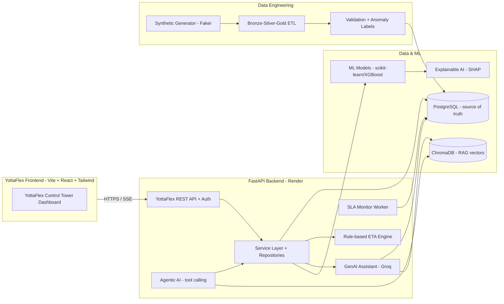

# YottaFlex — Architecture (High-Level)

> Status: Phase 1 foundation. This document is expanded in every phase; the
> full Low-Level Design, data dictionary, and Mermaid diagrams land in their
> respective phases (see the project roadmap in the README). The description
> below reflects the intended end-state architecture the codebase grows into.

## 1. Business problem

YottaFlex combines shipment events, route plans, weather conditions,
facility queues, carrier performance, and historical logistics data to:

- predict shipment delivery times,
- identify potential delays,
- explain the reasons behind those delays, and
- recommend appropriate actions to logistics operations teams.

It behaves like a professional logistics control tower.

## 2. High-level system architecture

## 3. Major subsystems (end-state)

| Subsystem | Responsibility | Phase |
|-----------|---------------|-------|
| Configuration & logging | Typed settings, structured logs | 1 |
| PostgreSQL schema & migrations | Normalized tables, FKs, indexes | 2-3 |
| Synthetic data generator | Deterministic, labelled demo data | 4 |
| Validation framework | Anomaly detection + ground truth | 5 |
| Bronze-Silver-Gold ETL | Cleaned, business-ready data | 6 |
| SQL analytics | CTE/window analytics queries | 7 |
| Rule-based ETA engine | Deterministic ETA snapshots | 8 |
| Delay detection & SLA | Status transitions + live monitoring | 9 |
| FastAPI REST + Auth | Endpoints, JWT, RBAC | 10 |
| Frontend dashboard | Interactive control tower | 11 |
| ETA ML model | Regression for remaining delivery hours | 12 |
| Delay ML model | Binary classification | 13 |
| Explainable AI | SHAP-derived explanations | 14 |
| Alerts & notifications | Persistent alerts + in-app center | 15 |
| GenAI assistant | Groq + Llama grounded in DB | 16 |
| RAG knowledge base | Local embeddings + ChromaDB + citations | 17 |
| Agentic AI | LangGraph tool-calling agent | 18 |
| Route what-if | Alternative route comparison | 19 |
| Human approval & audit | Approval workflow + audit log | 20 |
| Docker & deployment | Render backend + Vercel frontend | 21 |
| Testing | Integration/security/regression | 22 |
| Monitoring | Health endpoints + operational dashboards | 23 |
| Final documentation | README, LLD, diagrams, screenshots | 24 |

## 4. Design principles

- PostgreSQL is the single source of truth for operational state.
- Tracking event history is immutable; predictions are append-only snapshots.
- Derived values are always calculated from source records, never invented.
- Future-data leakage is prevented by time-aware feature queries.
- Business logic stays out of API code; ML stays out of application code.
- The LLM provider is abstracted behind a single config group (Groq only;
  OpenAI is never used). Business logic does not import a specific provider.
- Demo mode works with zero external credentials.

## 5. Deployment topology (target)

- **Frontend**: Vercel (React + Vite SPA, SPA rewrites, env-based API URL).
- **Backend**: Render web service (uvicorn, health check on `/api/health`).
- **Database**: PostgreSQL (local via Docker Compose; hosted in production).
- **Vector store**: ChromaDB (local persist; persistent/managed in production).

See `deployment.md` (added in Phase 21) for exact commands and verification.
