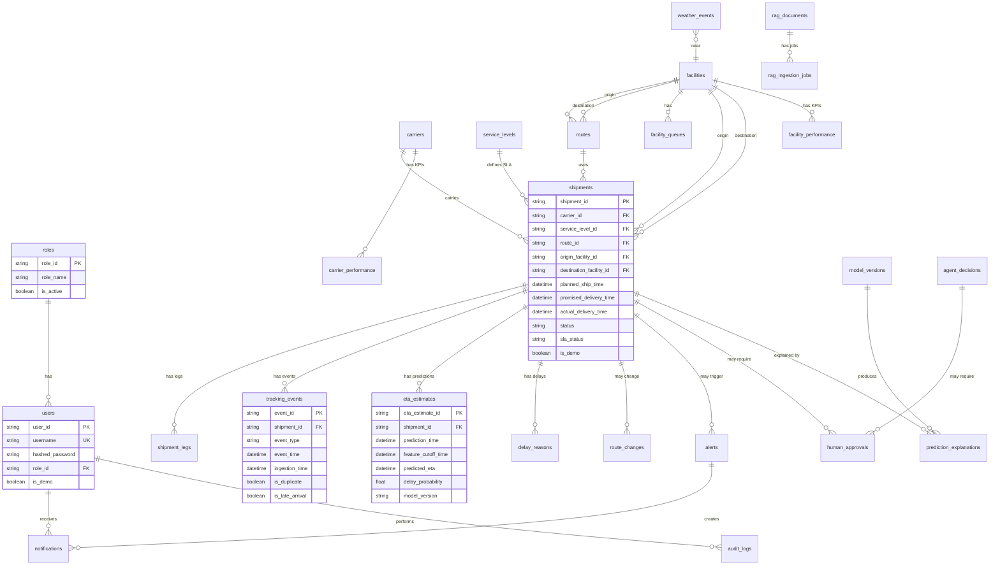

# YottaFlex — Database Design

## ER Diagram



## Key Design Principles

1. **Immutable history**: `tracking_events` and `audit_logs` are never updated or deleted.
2. **Append-only predictions**: `eta_estimates` rows are never overwritten — every prediction is a new row.
3. **Leakage prevention**: `feature_cutoff_time <= prediction_time` enforced by DB check constraint.
4. **Deterministic IDs**: All IDs follow documented formats (SHP-YYYY-NNNNNN, EVT-..., ETA-...).
5. **Derived values calculated**: utilization, carrier_score, delay_label — never independently generated.
6. **Ground truth separation**: `data_quality_issues.ground_truth_label` is never an ML input feature.
7. **Anomaly preservation**: Anomalies are labelled, not deleted. Silver layer has `is_anomaly` flag.

## Indexes

Key indexes on: `shipment_id`, `carrier_id`, `route_id`, `facility_id`, `event_time`, `ingestion_time`, `status`, `prediction_time`.

## Migrations

Alembic manages all schema changes:
```powershell
python -m alembic upgrade head      # apply all
python -m alembic history           # view history
```
